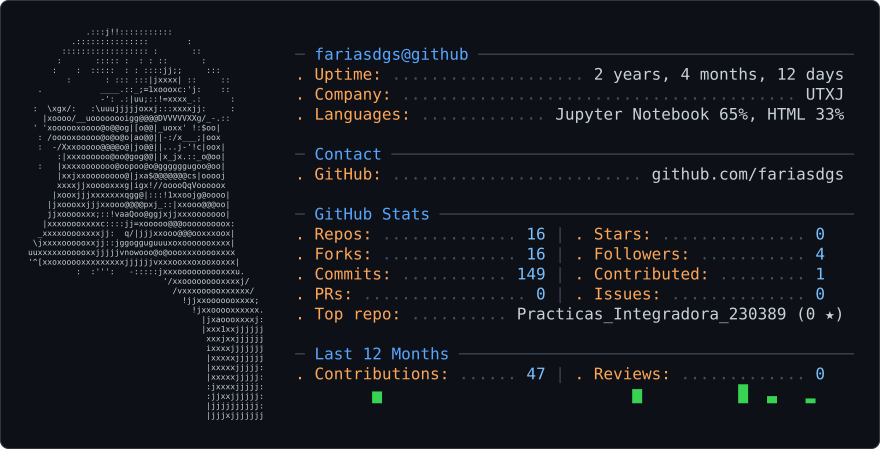

<!-- Tarjeta ASCII de GitHub -->

<picture>
  <source
    media="(prefers-color-scheme: dark)"
    srcset="./assets/dark_mode.svg"
  />
  <source
    media="(prefers-color-scheme: light)"
    srcset="./assets/light_mode.svg"
  />
  
</picture>

<!-- README.md de perfil GitHub -->

  
  &nbsp;&nbsp;&nbsp;
  

  # 👋 Hola, soy Al Farías Leyva

  ### Estudiante de Ingeniería en Desarrollo y Gestión de Software
  **Universidad Tecnológica de Xicotepec de Juárez — IDGS 10A**

---
